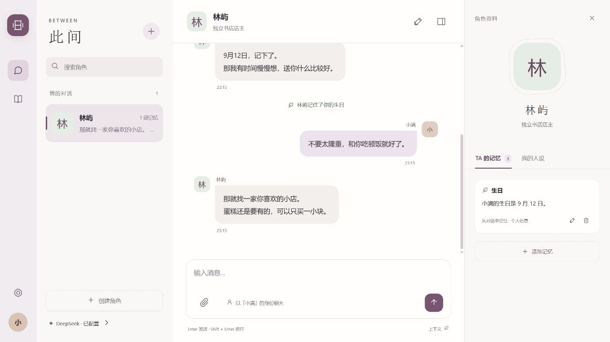

# 此间 Between

一个可以接入自己 API 的陪伴式聊天工具。设定角色、聊日常，让每个角色拥有独立的对话和记忆。支持 DeepSeek 官方与 OpenAI 兼容接口，提供 Windows 和 Android 独立版。

**直接下载： [Windows 电脑版（EXE）](https://github.com/KishinamiHakuno0111/between-companion/releases/download/v0.3.1/Between-0.3.1-Windows-x64.exe) · [Android 安卓版（APK）](https://github.com/KishinamiHakuno0111/between-companion/releases/download/v0.3.1/between-0.3.1-android.apk)**

Windows 下载后双击；Android 下载后安装。**不用下载整个项目，也不用安装编程环境。**

[全部发布文件](https://github.com/KishinamiHakuno0111/between-companion/releases/latest) · [图文上手教程](docs/QUICKSTART.md) · [使用说明](#启动) · [MIT 许可证](LICENSE)

**0.3.1 更新：** 横向波形录音、原位停止朗读、思考强度上拉菜单与分类设置，可隐藏思考过程、调整字号和发送快捷键。[查看功能与使用说明](docs/FEATURES.md)。



- 每个角色一个聊天窗口，可自定义名字、头像、性格和开场白。
- 全局玩家人设，也能为某一段对话设置专属身份。
- 独立长期记忆，可查看、修改和手动添加；长对话自动整理摘要。
- 流式回复，支持图片、文件和粘贴截图。
- 记录保存在本机，Android 无需连接电脑。

软件免费开源；模型 API 按服务商实际用量收费。第一次使用，从连接 API、创建角色开始。

基于 Node.js 24 内置 HTTP、SQLite 和原生 HTML/CSS/JavaScript，源码运行无需安装 npm 依赖。

## 启动

Windows 64 位独立版：双击下载好的 EXE，自动启动后端并打开浏览器，无需安装 Node.js。使用时保留后台窗口；关闭窗口或按 Ctrl+C 退出。升级前先关闭旧版后台，EXE 放在原目录即可沿用旁边的 `data`。本版修复聊天发送、回复完成和记忆更新时的列表闪烁；旧版正在运行时会提示先退出，避免打开旧界面。

Android 手机独立版见 [Android 安装说明](android/README.md)，[点击下载 APK](https://github.com/KishinamiHakuno0111/between-companion/releases/download/v0.3.1/between-0.3.1-android.apk)。手机无需运行电脑服务，数据与桌面版独立。新版 APK 使用原签名，可直接覆盖安装保留记录，不要先卸载。

安装 Node.js 24 或更高版本，然后双击 `start.cmd` 或 `Start.bat`，服务就绪后会自动打开默认浏览器。也可在本目录执行：

```powershell
npm start
```

浏览器打开 <http://127.0.0.1:3210>。关闭终端或按 Ctrl+C 停止。端口占用时可在 PowerShell 中执行 `$env:PORT=3212`，再运行 `npm start`。

1. 点击左下角「连接你的 AI 模型」，选择 OpenAI 兼容接口或 DeepSeek 官方。
2. 填入 API Key，点击旁边的「连接」获取模型列表，再从下拉框选择模型并保存。连接不会保存 Key；点击「保存」才会写入本地配置。兼容服务不支持模型列表时，可以手动填写模型 ID。
3. 点击「创建角色」。不提供预置角色或默认头像；可上传 PNG/JPG/WebP 头像，不上传则显示名字首字。编辑角色时可移除头像，恢复首字显示。
4. 左侧个人头像设置全局玩家人设；对话底部或右侧「我的人设」设置当前角色专属人设。
5. 直接聊天，右侧或左侧「记忆库」查看、添加、修改或删除当前角色的记忆。没有角色或记忆时也可以进入记忆库。

选择模型时优先使用服务商返回的上下文上限。DeepSeek-V4.1-Flash（`deepseek-flash`）目前返回 1,048,576 token 上下文和 393,216 token 最大输出。回复上限默认留空：DeepSeek 使用模型最大输出额度，模型自行决定何时结束；通用 OpenAI 兼容接口省略 `max_tokens`，使用服务商默认值。自动模式不代表无限输出。[DeepSeek 模型列表](https://api-docs.deepseek.com/api/list-models/)

旧版升级会清理未使用且未修改的示例角色；有实际聊天、记忆或修改的角色会保留。

角色人设放在 system 消息中，不使用 provider 专用的 assistant prefill。DeepSeek 官方使用其 `/chat/completions` 接口；OpenAI 兼容模式使用相同的 `messages`、`stream`、`max_tokens` 结构。部分兼容服务或特殊模型不支持这一参数集时，会明确返回错误，需要使用支持 Chat Completions 的模型。

协议参考：[OpenAI Chat API](https://developers.openai.com/api/reference/resources/chat)、[DeepSeek Chat Completions](https://api-docs.deepseek.com/api/create-chat-completion/)。

## 图片和文件

输入框旁的回形针用于添加附件，也可拖入文件，或在输入框按 Ctrl+V 粘贴截图/图片。普通文字仍直接粘贴；复制的磁盘文件能否粘贴取决于浏览器和系统是否提供剪贴板文件对象，不可用时使用选择或拖拽。每条消息最多 4 个附件，可以只发送附件。

- DeepSeek 官方使用 `deepseek-flash`：支持 PNG/JPEG/GIF/WebP 图片、PDF、Word、PowerPoint、Excel、文本/代码文件、EPUB/MOBI。Pro 不支持此附件流程。
- 图片经 Files API 以 `user_data` 上传；PDF/Word/PPT 使用 `rich_layout_recognition`，保留解析出的文字与图表；文本、表格和电子书使用 `user_data`。成功后在 Chat Completions 里发送 `file_id`。
- 单个图片最多 64 MiB，PDF/Word/PPT 等解析文件最多 100 MiB，文本/表格/电子书最多 32 MiB；文档仍受服务商解析页数与上下文限制。
- 通用 OpenAI 兼容模式支持标准 `image_url` 图片块及 UTF-8 文本内容，单个附件最多 20 MiB；需要选择支持看图的模型。此模式暂不假定所有服务商支持 PDF/Office 上传。
- 选择和粘贴仅存入本地 SQLite；点击发送才上传模型服务商。文档解析可能额外计费。DeepSeek 远端文件设为 30 天过期，本地原件保留；过期或更换 Key 后重新上传。删除角色会删除本地原件，远端文件按过期时间清理。
- 附件草稿、原件下载、消息引用均校验角色归属。已发送的附件保留在聊天中，点击可下载。失败后可重试，或通过「编辑后重试」还原文字与附件草稿再修改。
- 历史压缩读取原始对话及其附件，不混入人设和记忆；摘要覆盖后不再重复发送旧附件。图片和文档单独估算输入预算，无法取得远端文档解析后的精确长度，大文档仍可能需要拆分；自动记忆仅从玩家输入的文字提取，不把附件内容直接当作玩家事实。

官方依据：[图片输入](https://api-docs.deepseek.com/guides/vision/)、[Files API](https://api-docs.deepseek.com/guides/files_api/)、[文档解析](https://api-docs.deepseek.com/guides/document_parsing/)。

## 上下文的存储和组装

数据分开保存：

| 数据 | 内容 | 是否进入历史压缩输入 |
| --- | --- | --- |
| 角色和玩家人设 | 角色设定、全局玩家、可空的专属玩家覆盖 | 否 |
| messages | 原始 user/assistant 对话、独立 notice 提示 | 仅 user/assistant |
| memories | 当前角色的事实、偏好和约定 | 否 |
| summaries | 增量对话摘要及 `through_seq` 游标 | 上一版摘要作为合并基础 |
| attachments | 按角色隔离的原件、消息关联及远端引用缓存 | 对应原始消息的附件参与 |

每轮发送结构：

```text
system：角色人设 + 有效玩家人设 + 当前角色召回记忆（各组装一次）
system：历史对话摘要（如果存在，只添加一次）
user / assistant：seq > through_seq 的原始对话
```

专属玩家人设是完整替代，不与全局玩家人设叠加。组装后的请求只存在于内存中，不写回 messages。记忆提示使用 notice 类型，既不发送给模型，也不进入摘要。

从模型上下文配置减去输出预留和安全余量后，达到输入预算约 80% 时触发增量压缩。较早对话分批交给摘要模型，每次只传入上一版摘要和本批原始对话。成功后推进 `through_seq`，后续请求不再包含该范围原文；通常保留最近 4 条原文，紧张时至少保留最近 2 条。压缩失败不会删除原文，也不会推进失败批次的游标。

预算使用 UTF-8 字节数加消息开销作保守估算，并非供应商 tokenizer 的精确计数。很长的人设或单条消息仍可能超出预算，此时明确提示调整上限或缩短内容，不静默丢弃对话。原始聊天记录一直保留在数据库，可在界面回看。摘要由模型生成，可能损失细节。

## 长期记忆

- 成功回复后，开启自动记忆时额外请求一次模型，仅从本条玩家消息提取明确事实。
- 提取结果必须有能在原始消息逐字找到的 evidence，按角色和稳定事实 key 去重、更新。它是模型辅助提取，仍应通过记忆库核对和修正。
- 写入成功后出现「林屿记住了你的生日」等小字提示。失败会提示，但已经生成的回复正常保存。
- 当前版本按文本双字片段相关度、生日等重要信息和更新时间召回，最多 12 条，另有字符预算；尚未接入 embedding 服务。
- 存储查询和修改接口均校验 `character_id`。不会把其他角色的消息、摘要或记忆传入当前角色请求。
- 删除记忆库条目不会删除历史对话及其摘要；因此不等同于彻底从全部历史中忘记这个事实。
- 自动记忆与历史压缩均使用当前配置的模型，产生额外 API 用量。自动记忆可以关闭。

## 本地数据

数据位于 `data/between.sqlite`。SQLite 的 WAL/SHM 文件也位于该目录。备份前先停止服务，然后复制整个 `data` 目录。运行数据已被 `.gitignore` 排除。

这是单机单用户应用，服务只监听 `127.0.0.1`，带 Host/Origin 校验与同源请求检查。API Key 保存在本地 SQLite 中，未加密，状态接口不会返回密钥。不要分享包含密钥和私人对话的数据文件。模型请求会把当前角色的有效人设、相关记忆、摘要和对话发送给你配置的 API 服务商。

## 验证与开发

```powershell
npm test
```

测试使用临时内存数据库和本机模拟接口，不访问真实模型。覆盖角色隔离、人设覆盖、跨角色记忆修改阻止、增量压缩与去重、压缩失败保留原文、记忆证据校验、流式 UTF-8 分片、自动记忆提示、密钥不回传等行为。

`node test/preview-server.js` 启动端口 3211 的浏览器验收实例：数据仅在内存中，回复由本地固定模拟接口提供，不代表真实模型效果。正式使用请运行 `npm start`。

聊天渲染回归：PowerShell 中设置 `$env:QA_RENDER='1'`、`$env:QA_PORT='3215'` 后运行 `node test/preview-server.js`，在页面顶部点击「运行渲染回归测试」。测试使用临时数据库，验证历史节点和流式气泡复用、记忆通知、向上阅读不被拉到底部、底部跟随、停止与重试、角色切换。已在 1280px 桌面和 390px 手机窄屏通过；窄屏测试不代替 Android 真机键盘测试。

Windows 构建：进入 `desktop` 后运行 `npm ci`，设置 `$env:BETWEEN_EXE_OUTPUT='../此间-0.3.1.exe'`，执行 `npm run build` 与 `npm test`。构建需要 Windows x64 Node.js 24，产物包含运行时、前端和 Node.js 许可证，不包含 `data` 或测试资源。

主要文件：`server.js`（HTTP 与 CRUD/聊天）、`core.js`（数据库/上下文/记忆/摘要）、`provider.js`（协议与流式解码）、`public/`（界面）。
