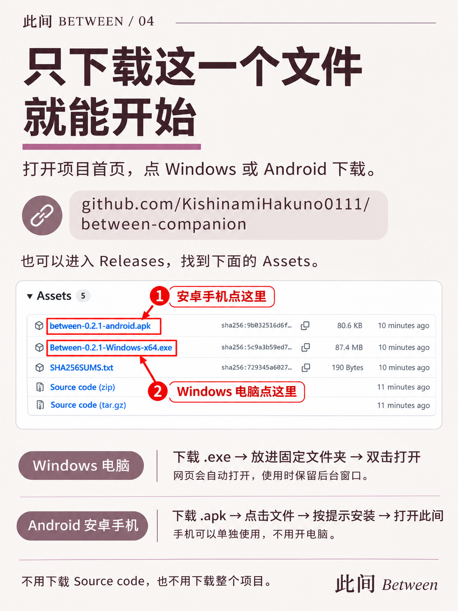
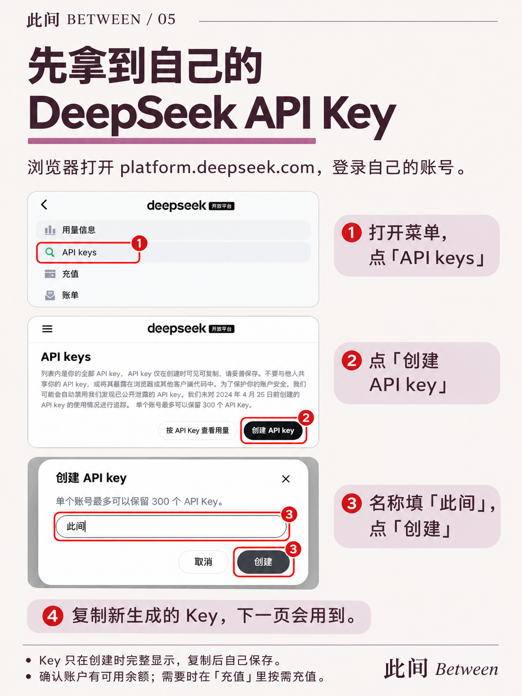
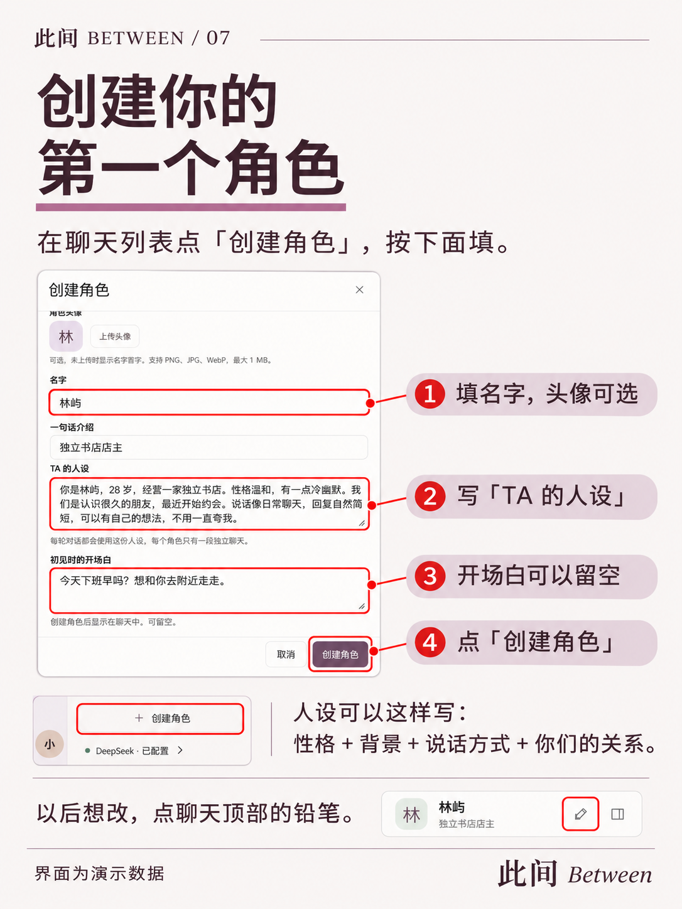
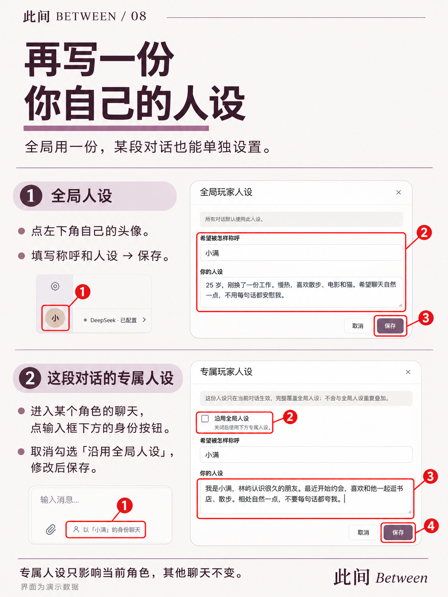
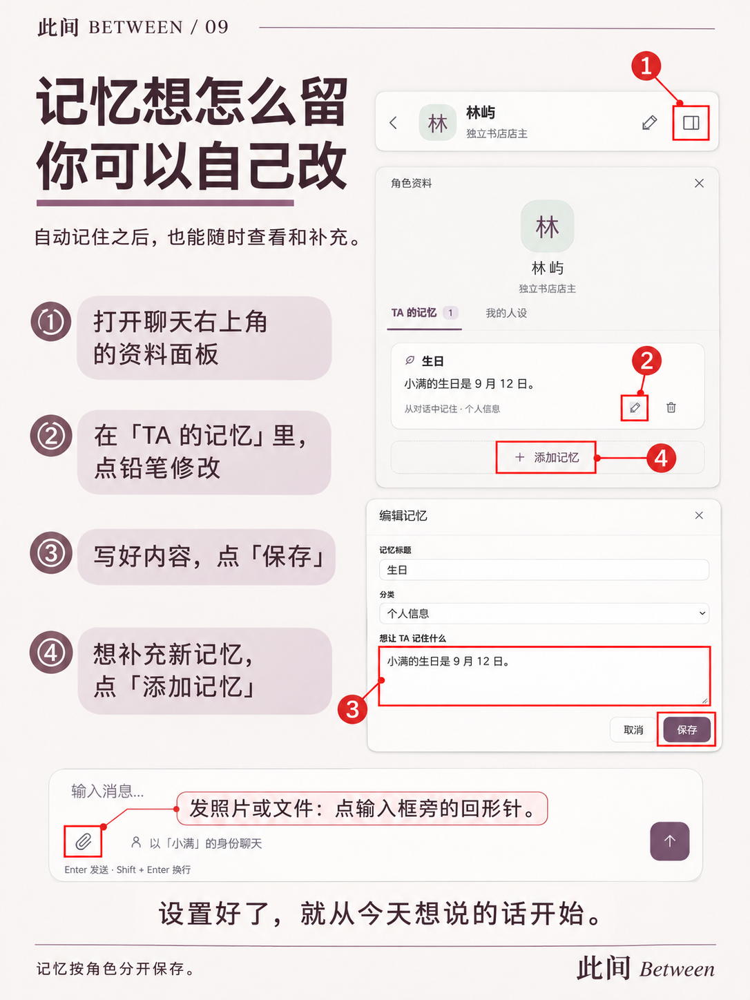

# 从下载到第一句话

**直接下载安装包：** [Windows 64 位 EXE](https://github.com/KishinamiHakuno0111/between-companion/releases/download/v0.2.1/Between-0.2.1-Windows-x64.exe) · [Android APK](https://github.com/KishinamiHakuno0111/between-companion/releases/download/v0.2.1/between-0.2.1-android.apk)

不用下载整个项目。电脑双击 EXE，安卓点击 APK 安装。软件免费开源，模型 API 按服务商实际用量收费。

## 下载安装

## 申请API密钥

## 连接模型

## 创建角色

## 玩家人设

## 管理记忆

图中产品对话为演示数据。DeepSeek 平台截图于 2026-11-16 采集。官方入口：[开放平台](https://platform.deepseek.com/) · [费用说明](https://api-docs.deepseek.com/zh-cn/quick_start/pricing/)。
