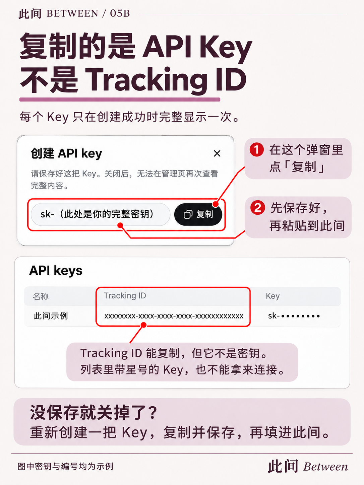
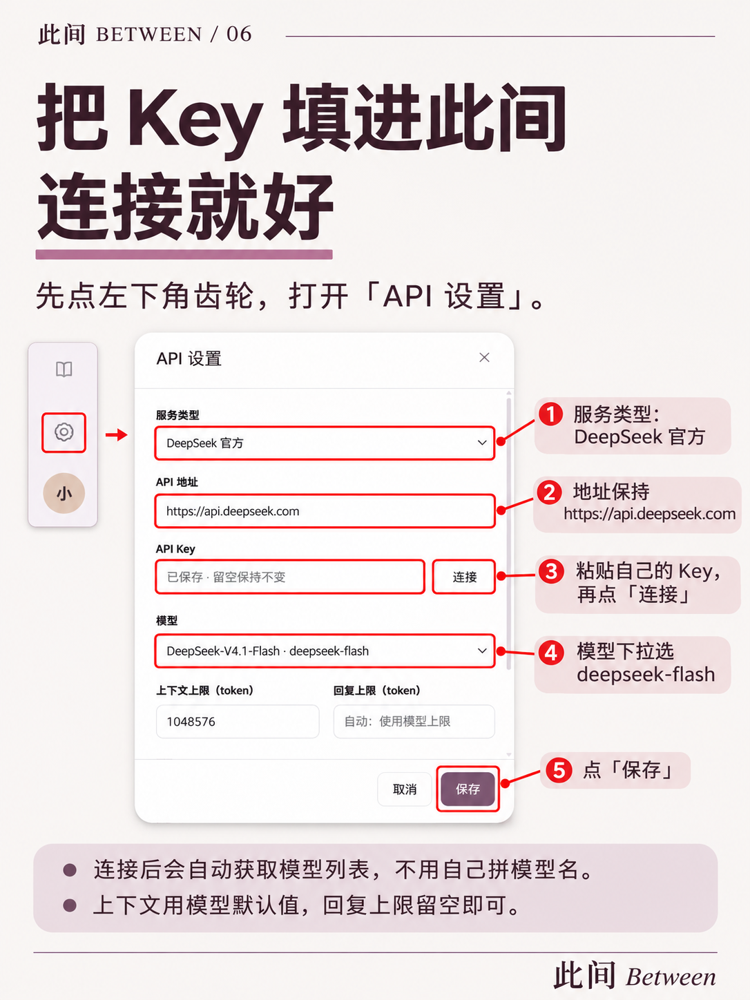

# 从下载到第一句话

当前版本 **0.3.2**。[新版联网、思考与语音功能说明](FEATURES.md)。下面截图里的 0.2.1 是旧版文件名示例，下载时以 README 链接或最新 Release 的 0.3.2 安装包为准。

**直接下载安装包：** [Windows 64 位 EXE](https://github.com/KishinamiHakuno0111/between-companion/releases/download/v0.3.2/Between-0.3.2-Windows-x64.exe) · [Android APK](https://github.com/KishinamiHakuno0111/between-companion/releases/download/v0.3.2/between-0.3.2-android.apk)

不用下载整个项目。电脑双击 EXE，安卓点击 APK 安装。软件免费开源，模型 API 按服务商实际用量收费。

两种下载方式任选一种：在项目首页向下滑过文件列表，找到 README 的「直接下载」链接；或打开 Releases 的最新版本，在 Assets 中下载 Windows 的 `.exe` 或安卓的 `.apk`。

## 下载安装

## 申请API密钥

## 认准APIKey

**API Key 与 Tracking ID 是两回事：**

- 每个完整 API Key 只在创建成功时显示一次，在弹窗里点击「复制」，妥善保存后再填入此间。
- 管理列表里的 Tracking ID 即使可以复制，也不能用作 API Key；列表中带星号的 Key 同样不是完整密钥。
- 如果没有保存且已关闭弹窗，需要重新创建 Key。管理页无法再次显示原来的完整 Key。

## 连接模型

## 创建角色

## 玩家人设

## 管理记忆

图中产品对话为演示数据。DeepSeek 平台截图于 2026-11-16 采集。官方入口：[开放平台](https://platform.deepseek.com/) · [费用说明](https://api-docs.deepseek.com/zh-cn/quick_start/pricing/)。
